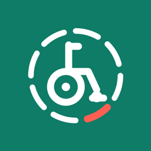
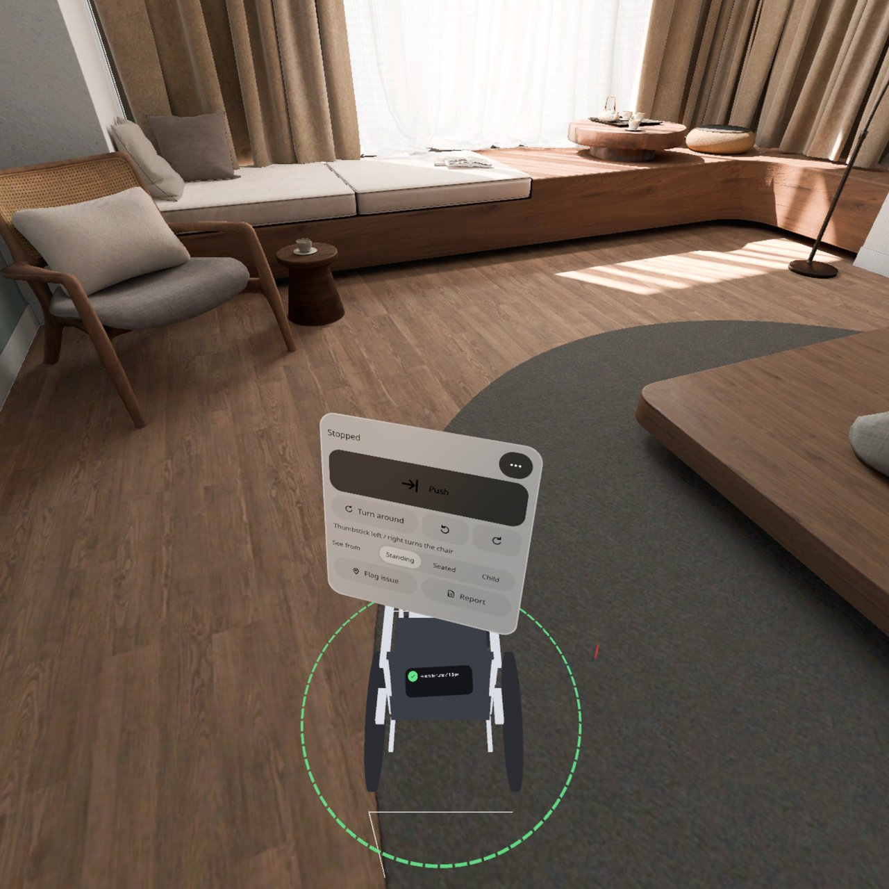
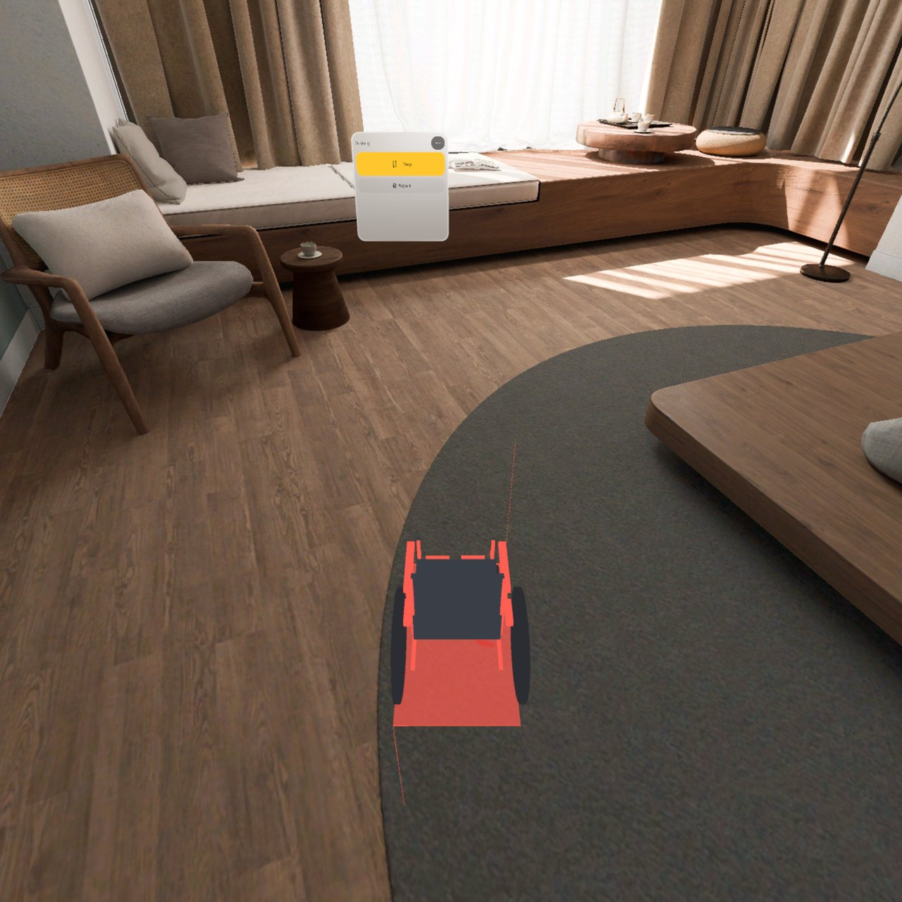
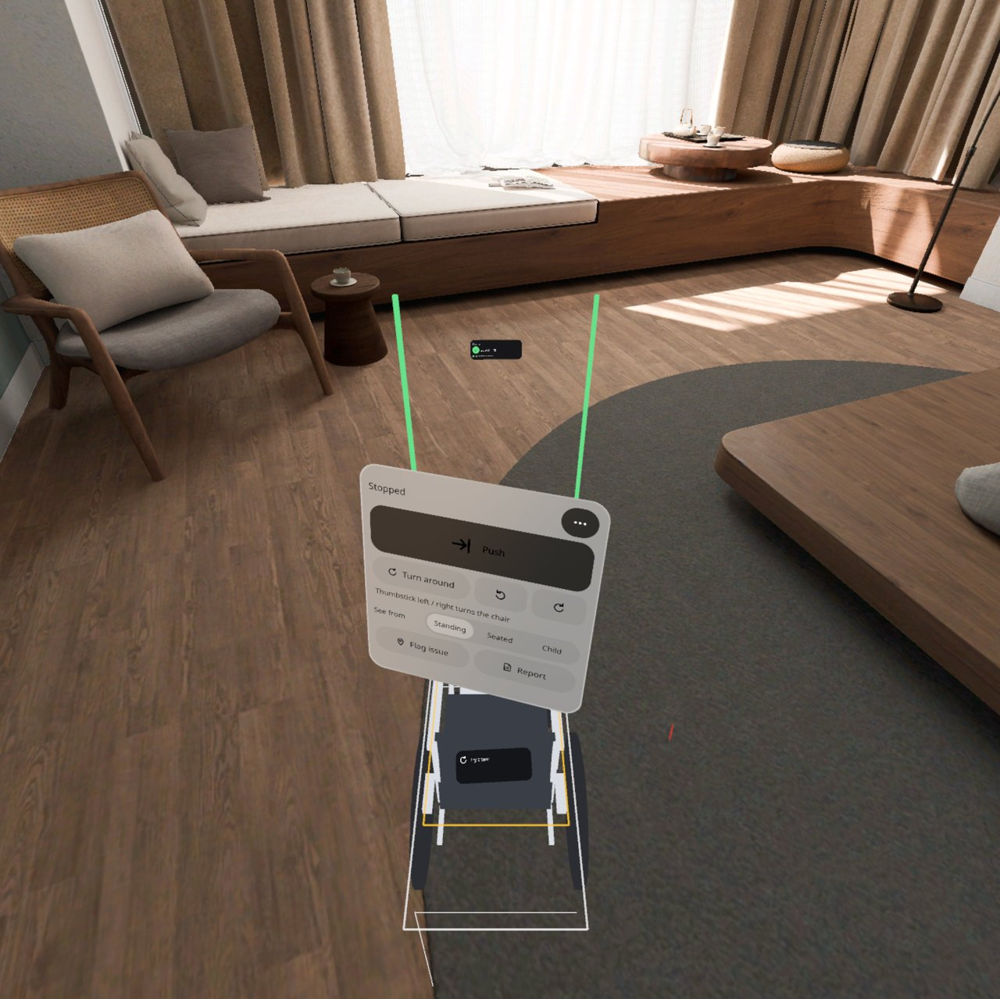
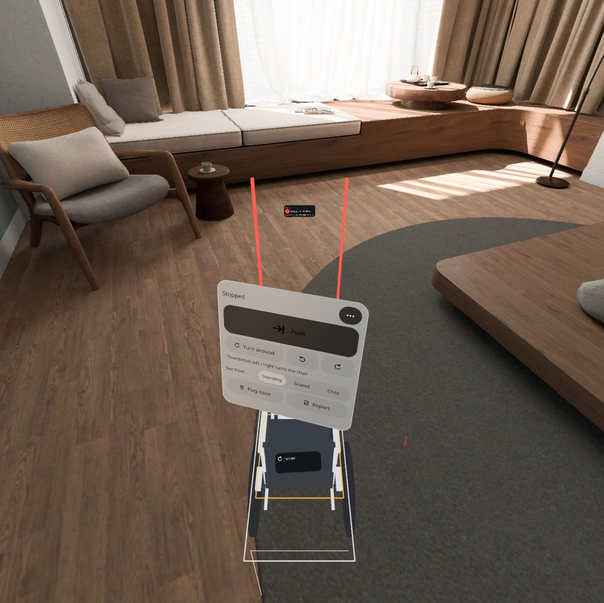
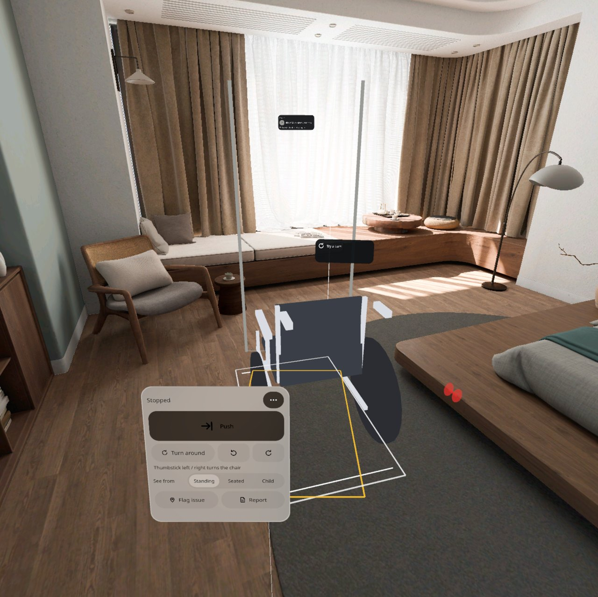
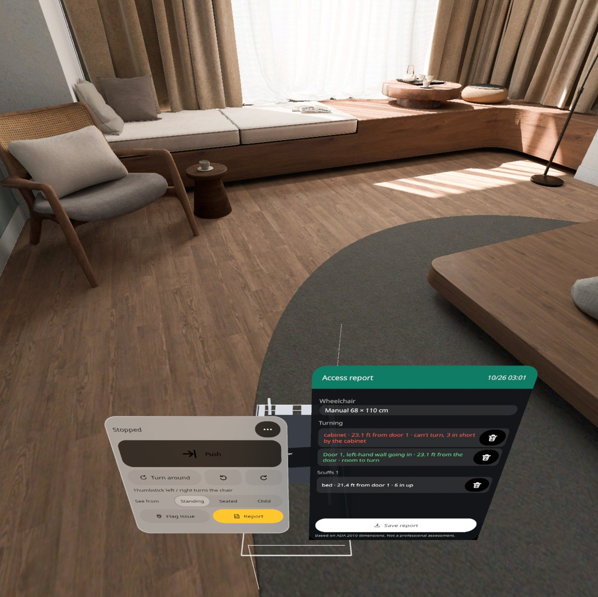
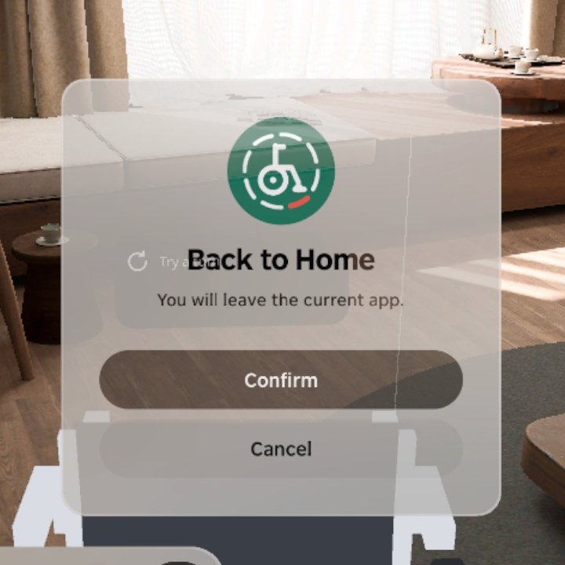

<p align="center"></p>

# Access Check | 无障碍体检

**推着一台 1:1 虚拟轮椅在你家卫生间走一圈：撞到哪儿哪儿留红印，转身圆、门宽门槛当场亮绿或红，最后存一份报告。**

**Push a life-size virtual wheelchair around your own bathroom: whatever it bumps turns red and leaves a scuff, the turning circle and the door width / threshold light up green or red on the spot, and you save a report at the end.**

PICO OS 6 · PICO Spatial SDK 6.1.9 · Kotlin / SpatialUI · package `io.embodit.accesscheck` · v0.1.2 (pre-release / 预发布)

> **v0.1.2：按真机反馈改了放好后的推动（按住扳机 / 握把或手握推把推着走）和面板朝向，QA 待复核；真机未全面验证（v0.1.2: pushing after placing reworked after headset feedback — hold trigger / grip or grab the handle; QA re-check pending; not fully verified on a headset）。**



> 截图和演示视频来自原生模拟器（PICO Emulator 6.1），由调试广播和模拟器鼠标（= 视线 + 捏合）驱动；**非真实手势录像**，演示视频无声。模拟器系统语言是美式英文，所以截图里界面是英文、读数单位是英寸。
> Screenshots and the demo video were taken on the native PICO emulator, driven by debug broadcasts and the emulator mouse (standing in for gaze + pinch); **not a recording of real hand gestures**; the demo video has no sound. The emulator's system language is US English, so the UI is in English and readings are in inches.

---

## 中文

### 这是什么

装修或改造前，先用一台和真的一样大的轮椅在家里走一圈。在体检台上点「放轮椅」，一台半透明的手动（68 × 110 cm）或电动轮椅跟着你手柄射线指到的地面走，扣扳机就放下（没有手柄就对着地面捏合），摇杆左右转朝向。放好后用射线指着轮椅按住扳机就能拖着它沿地面走，不用自己走过去；也可以点「推着走」，像推真轮椅一样往前走，它就跟着你的手走。车身碰到墙、柜子、马桶就变红，墙上留下撞痕。

停下后可以点「转一圈」：轮椅原地转一圈，地上画出 1.5 米转身圆，够不够一眼看出，转不开的那一侧标红并给出差多少。地上还会画出轮椅停放需要的净地面框。走到门口，门两侧亮出竖条：绿色过得去、橙色勉强、红色过不去，点门牌可以输入实际量的门宽和门槛高度。「换高度看」可以切到坐轮椅（1.20 m）或小孩（1.00 m）的眼高，看看坐着能不能够到、看到。觉得哪儿有问题就「标问题」钉一个钉子，选「够不着 / 看不到 / 有危险」。最后存一份文字报告到「下载/AccessCheck」。中英双语，单位厘米或英寸，不联网。

### 安装与启动

```bash
adb shell am force-stop io.embodit.accesscheck
adb install -r AccessCheck-v0.1.2.apk
pico-cli app launch io.embodit.accesscheck
```

APK 在 [Releases](https://github.com/kejing-dev/AccessCheck/releases) 页面下载（仓库不含 APK）。需要 PICO OS 6 头显或 PICO Emulator 6.1；用到平面识别和空间网格。APK 约 46 MB（内含完整中文字体）。覆盖安装前先停应用。

### 容器与骨架

- **容器**：只有 Full Space · `STAGE_MIXED`（透视），没有 Shared Space 版本。轮椅要 1:1 落在真实地板上、和真实墙面家具算碰撞，靠你真实走动来推，依赖平面识别、空间网格和头部位姿，只在 Full Space 可用。
- **骨架 D**（同火情预案 Fire Plan / 空间尺 Spatial Ruler）：平面识别、懒跟随面板、预建面板池、每帧系统（推着走、碰撞、拖动、摇杆、转圈动画、面板摆放）。墙、门洞、家具和空间网格合成一张 5 cm 的障碍图；轮椅由代码拼成，方块用自拼的单位立方体（模拟器上 SDK 标准方块会画成两倍大）。
- **状态**：设计包 30 个状态（S1–S30），全部可由调试广播直接跳转并截图，结构见 [AGENTS.md](AGENTS.md)。

### 截图

| | |
|---|---|
|  |  |
| 撞到了 — 车架和脚印变红，墙上留撞痕 | 转不开 — 靠柜子一侧标红，给出差多少 |
|  |  |
| 门 · 过得去 — 绿色竖条 + 门牌 | 门 · 过不去 — 红色竖条 |
|  |  |
| 门前吸附 — 松手吸到门前黄框（位置和朝向） | 报告 — 存成文字文件到「下载/AccessCheck」 |

启动器图标：



### v0.1.2 改了什么（第二次真机反馈）

- **放好后按住就推**：手柄射线指着轮椅（或手柄靠近推把）按住扳机或握把，轮椅就跟着手柄走，松开就停在那儿（门前照样吸附）。推把和手柄的相对位置在按下那一刻锁住，往前推跟着走、边推边往旁边带就转弯、往回拉就直着倒；两只手柄一起握住时，转动两手就转轮椅。摇杆左右照样转。不再跟着射线在地面的落点跑。
- **手势也能推**：手伸到推把上握拳（或捏合）就抓住，松开就放下，同样跟着手走；两只手一起握也行。
- **面板跟着头、面朝头**：体检台懒跟随你的水平朝向，停在视线下方约 18°，你走到哪儿它都转过来正对你；不再挂到推把外侧。
- 没有手柄时，摆放幽灵跟手的指向射线走（不再用头的朝向）。
- **轮椅尺寸可调**：「更多」里选手动 / 电动 / 儿童预设，或用滑杆调宽（55–80 cm）、长（90–130 cm）、高（80–110 cm），3D 轮椅、碰撞、门宽判定、报告都跟着变，下次打开还记得。轮椅调宽后，门要够「轮椅宽 + 5 cm」才算通过。
- **配色更清楚**：深色大按钮上改用白字白图标（原来深灰底黑字，对比度只有 3.3:1）；选中的选项一律黄底深字；滑杆轨道加深。所有文字对比度 ≥ 4.5:1。
- 站在停着的轮椅正后方时，体检台最多抬到视线下方、再往左让开一点，不再抬到视线上方；轮椅铭牌挪到车头上方，不再挡在脸前。

### v0.1.1 改了什么（用户真机反馈后的打磨）

- **轮椅跟着手柄射线在地面的落点走**：半透明「幽灵」实时跟随，扳机放下；没手柄时对着地面捏合放下，或点体检台「放在这里」。射线指天或超过 6 米时停在上一个有效点并提示「请指向地面」。默认背对你（推的方向），摇杆左右转。
- **放好后随时能挪**：射线指着轮椅按住扳机拖动，松开放下；体检台上有「移到面前」「重新摆放」。
- **不挡脸**：轮椅中心离你的头水平至少 0.8 米，落进去就推出去；你走进轮椅时它变半透明。
- **推着走时体检台挂在推把外侧**（QA q1-1 修复），推着走 / 停在推把后时轮椅不再挡住按钮；其他时候体检台被轮椅挡住会自动抬高。
- **面板只跟水平朝向**：低头看门槛时体检台不再掉到身下；体检台在视线下方约 18°，提示条贴在体检台上沿，不用抬头。标题栏有「静音」和「面板回到面前」。
- **扫不到地面 5 秒后用标准地面**继续，不卡在「正在找地面」。
- 「撞到了」提示和撞击声恢复；转一下（15°）后也能吸附到门前黄框。

### 已知问题（QA 第 1 轮，v0.1.1 后）

1. ~~推着轮椅走时体检台落在车背后面，「停下」点不到~~ —— v0.1.1 已改：体检台挂到推把外侧。
2. ~~「撞到了」提示和撞击声不出~~ —— v0.1.1 已修。
3. ~~更多菜单里英文「Wheelchair」被截成「Wheelchai」~~ —— v0.1.1 已改：英文标签改为「Chair」。
4. ~~转一下后不吸附门前黄框~~ —— v0.1.1 已修（吸附角度 16°）。
5. ~~英文报告里夹着中文全角括号和冒号~~ —— v0.1.1 已修。
6. 仅调试路径：直接跳到「撞了」状态撞不上墙；调试眼高覆盖会把体检台挪走，关掉后读数错到重开。真实路径正常。

还没在头显上验过：手柄射线放轮椅、按住扳机 / 握把推轮椅、手握推把推轮椅（模拟器没有手柄和手部追踪，用调试广播模拟验证）、手柄摇杆转轮椅、真走路推轮椅的手感、真坐下 / 蹲下的眼高、马桶台盆柜这类靠空间网格识别的障碍准不准、厘米级碰撞、门宽自动读数和实际净宽差多少、权限流程、PICO 文件管理器能不能看到报告。

---

## English

### What it is

Before a renovation, walk your home with a wheelchair exactly the size of a real one. Tap Place wheelchair on the console and a see-through manual (68 × 110 cm) or power chair follows the point where your controller ray meets the floor; pull the trigger to put it down (no controller: pinch at the floor), turn it with the thumbstick. Point at the parked chair and hold the trigger to drag it along the floor without walking over; or tap Push and walk forward as if pushing it, and it follows your hands. Anything the frame touches — wall, cabinet, toilet — turns red and leaves a scuff on the wall.

Stopped, tap Turn around: the chair spins on the spot and a 1.5 m turning circle shows on the floor, red on the side where it is short, with how much is missing. The clear-floor rectangle for parking is drawn too. At a doorway, bars light up on both sides of the frame: green passes, orange is tight, red does not pass; tap the door plate to enter the measured width and threshold. See from switches to a seated (1.20 m) or child (1.00 m) eye height. Flag an issue to pin a spot (out of reach / can't see / hazard). At the end, save a text report to Download/AccessCheck. Chinese and English, cm or inches, offline.

### Install and launch

```bash
adb shell am force-stop io.embodit.accesscheck
adb install -r AccessCheck-v0.1.2.apk
pico-cli app launch io.embodit.accesscheck
```

Download the APK from the [Releases](https://github.com/kejing-dev/AccessCheck/releases) page (the repository itself does not ship an APK). Needs a PICO OS 6 headset or PICO Emulator 6.1; uses plane detection and the spatial mesh. The APK is about 46 MB because it bundles the full Chinese font. Stop the app before reinstalling over it.

### Container and skeleton

- **Container**: Full Space only, `STAGE_MIXED` (passthrough); no Shared Space version. The chair stands life-size on the real floor, collides with real walls and furniture and is pushed by your real walking, which needs plane detection, the spatial mesh and head pose — Full Space only.
- **Skeleton D** (same as Fire Plan / Spatial Ruler): plane detection, lazy-follow panel, pooled panels, a per-frame system (push follow, bumps, drag, thumbstick, turn animation, panel placement). Walls, doorways, furniture and the spatial mesh are merged into a 5 cm obstacle grid; the chair is built in code from a hand-made unit cube (the SDK's standard box draws twice the size on the emulator).
- **States**: 30 designed states (S1–S30), each reachable by a debug broadcast and captured; see [AGENTS.md](AGENTS.md).

### Screenshots

See the table above: a bump, a turning circle that is short, a door that passes and one that does not, snapping at a door, and the report card.

### What changed in v0.1.2 (second round of headset feedback)

- **Hold it to push it**: point the controller ray at the parked chair (or bring the controller to the push handle) and hold the trigger or the grip; the chair moves with the controller and stops where you let go (door snap still applies). The handle's place relative to the controller is locked when you press: push forward and it follows, drift sideways while pushing and it turns, pull back and it reverses straight; holding with both controllers, turning your hands turns the chair. The thumbstick still turns it. It no longer chases the ray's floor point.
- **Hands too**: close a fist (or pinch) at the push handle to take hold, open to let go; it follows your hand, or both hands.
- **Panels follow your head and face you**: the console lazily follows your heading about 18° below eye level and turns to face you wherever you stand; it no longer hangs beside the push handle.
- Without a controller the placing ghost follows the hand's pointing ray (not where your head looks).
- **Adjustable chair size**: in More pick the manual / power / child preset or set width (55–80 cm), length (90–130 cm) and height (80–110 cm) with sliders; the 3D chair, bumps, door verdicts and the report follow, and the size is remembered. A widened chair needs a door of its width + 5 cm to pass.
- **Clearer colours**: white text and icons on the dark big buttons (they were black on grey, 3.3:1); every selected option is yellow with dark text; a darker slider track. All text is at least 4.5:1.
- Standing right behind the parked chair, the console rises no higher than just under your eyes and slides a little aside; the chair's plate floats over its front end, not in your face.

### What changed in v0.1.1 (polish after headset feedback)

- **The chair follows where your controller ray meets the floor**: a see-through ghost tracks it live, the trigger puts it down; without a controller pinch at the floor or tap Put it here. A ray aimed at the sky or past 6 m keeps the ghost on the last good point with "Point at the floor". It faces away from you (the pushing direction); the thumbstick turns it.
- **Move it any time**: point at the chair and hold the trigger to drag it; Bring here / Place again on the console.
- **Never in your face**: the chair's centre stays at least 0.8 m from your head; walk into it and it turns see-through.
- **While pushing, the console hangs beside the push handle** (QA q1-1 fixed); elsewhere it rises when the chair would hide it.
- **Panels follow your heading only**: looking down at a threshold no longer drops the console under you; it sits about 18° below eye level with the hint bar on its top edge. Mute and Bring the panel back keys in its title row.
- **No floor after 5 s → a standard floor**, never stuck on "Looking for the floor".
- The "Bumped" hint and sound are back; one 15° turn still snaps to the door frame.

### Known issues (QA round 1, after v0.1.1)

1. ~~Console behind the backrest while pushing~~ — fixed in v0.1.1 (console beside the push handle).
2. ~~"Bumped" hint and sound never appear~~ — fixed in v0.1.1.
3. ~~"Wheelchair" is cut to "Wheelchai" in the English More menu~~ — fixed in v0.1.1 (the label now reads "Chair").
4. ~~No door snap after one 15° turn~~ — fixed in v0.1.1 (16° snap angle).
5. ~~The English report contains full-width Chinese brackets and colons~~ — fixed in v0.1.1.
6. Debug paths only: jumping straight to the "bumped" state does not hit the wall; the debug eye-height override moves the console away and leaves a wrong reading until restart. Real paths are fine.

Not yet verified on a headset: placing with the controller ray, pushing with a held trigger / grip or a hand closed on the handle (the emulator has no controllers or hand tracking; verified with debug stand-ins), thumbstick turning, the feel of pushing by walking, real seated / crouching eye heights, how well the spatial mesh catches toilets and basin cabinets, centimetre-level bumps, automatic door width versus the real clear width, the permission flow, and whether the PICO file manager shows the report.

---

## License

Source code © 2026 Embodit. All rights reserved (private repository). Bundled fonts Noto Sans / Noto Sans SC are under the SIL Open Font License, see `third_party/`. Reference dimensions follow ADA guidance (public values); this is a planning aid, not a compliance certificate.
