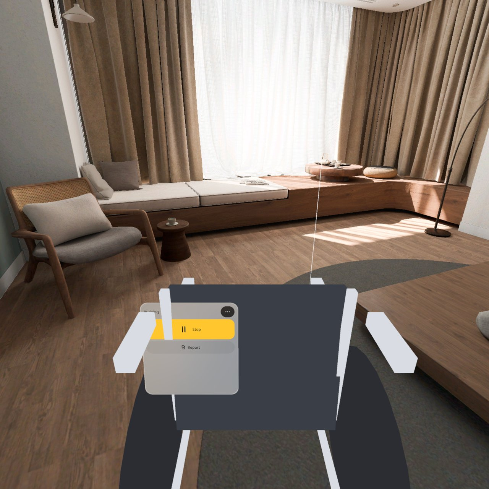

<p align="center"></p>

# Access Check | 无障碍体检

**推着一台 1:1 虚拟轮椅在你家卫生间走一圈：撞到哪儿哪儿留红印，转身圆、门宽门槛当场亮绿或红，最后存一份报告。**

**Push a life-size virtual wheelchair around your own bathroom: whatever it bumps turns red and leaves a scuff, the turning circle and the door width / threshold light up green or red on the spot, and you save a report at the end.**

PICO OS 6 · PICO Spatial SDK 6.1.9 · Kotlin / SpatialUI · package `io.embodit.accesscheck` · v0.1.0 (pre-release / 预发布)

> **模拟器 QA 通过（1 条设计问题待下版），真机未验证（Simulator QA gates passed, with one design issue left for the next version; not yet verified on a real headset）。**


> 截图和演示视频来自原生模拟器（PICO Emulator 6.1），由调试广播和模拟器鼠标（= 视线 + 捏合）驱动；**非真实手势录像**，演示视频无声。模拟器系统语言是美式英文，所以截图里界面是英文、读数单位是英寸。
> Screenshots and the demo video were taken on the native PICO emulator, driven by debug broadcasts and the emulator mouse (standing in for gaze + pinch); **not a recording of real hand gestures**; the demo video has no sound. The emulator's system language is US English, so the UI is in English and readings are in inches.

---

## 中文

### 这是什么

装修或改造前，先用一台和真的一样大的轮椅在家里走一圈。在体检台上点「放轮椅」，一台手动（68 × 110 cm）或电动轮椅落在你前面的地板上，你像推真轮椅一样往前走，它就跟着你的手走。车身碰到墙、柜子、马桶就变红，墙上留下撞痕。

停下后可以点「转一圈」：轮椅原地转一圈，地上画出 1.5 米转身圆，够不够一眼看出，转不开的那一侧标红并给出差多少。地上还会画出轮椅停放需要的净地面框。走到门口，门两侧亮出竖条：绿色过得去、橙色勉强、红色过不去，点门牌可以输入实际量的门宽和门槛高度。「换高度看」可以切到坐轮椅（1.20 m）或小孩（1.00 m）的眼高，看看坐着能不能够到、看到。觉得哪儿有问题就「标问题」钉一个钉子，选「够不着 / 看不到 / 有危险」。最后存一份文字报告到「下载/AccessCheck」。中英双语，单位厘米或英寸，不联网。

### 安装与启动

```bash
adb shell am force-stop io.embodit.accesscheck
adb install -r AccessCheck-v0.1.0.apk
pico-cli app launch io.embodit.accesscheck
```

APK 在 [Releases](https://github.com/kejing-dev/AccessCheck/releases) 页面下载（仓库不含 APK）。需要 PICO OS 6 头显或 PICO Emulator 6.1；用到平面识别和空间网格。APK 约 46 MB（内含完整中文字体）。覆盖安装前先停应用。

### 容器与骨架

- **容器**：只有 Full Space · `STAGE_MIXED`（透视），没有 Shared Space 版本。轮椅要 1:1 落在真实地板上、和真实墙面家具算碰撞，靠你真实走动来推，依赖平面识别、空间网格和头部位姿，只在 Full Space 可用。
- **骨架 D**（同火情预案 Fire Plan / 空间尺 Spatial Ruler）：平面识别、懒跟随面板、预建面板池、每帧系统（推着走、碰撞、拖动、摇杆、转圈动画、面板摆放）。墙、门洞、家具和空间网格合成一张 5 cm 的障碍图；轮椅由代码拼成，方块用自拼的单位立方体（模拟器上 SDK 标准方块会画成两倍大）。
- **状态**：设计包 30 个状态（S1–S30），全部可由调试广播直接跳转并截图，结构见 [AGENTS.md](AGENTS.md)。

### 截图

| | |
|---|---|
|  |  |
| 撞到了 — 车架和脚印变红，墙上留撞痕 | 转不开 — 靠柜子一侧标红，给出差多少 |
|  |  |
| 门 · 过得去 — 绿色竖条 + 门牌 | 门 · 过不去 — 红色竖条 |
|  |  |
| 门前吸附 — 松手吸到门前黄框（位置和朝向） | 报告 — 存成文字文件到「下载/AccessCheck」 |

启动器图标：


### 已知问题（QA 第 1 轮）

1. **推着轮椅走时，体检台落在车背后面，「停下」点不到。** 体检台浮在你面前约 0.6 米、偏下 26–32°，而轮椅推把在你前面 0.35 米、车背高 0.92 米，于是体检台正好藏在车背后，点下去都点到了轮椅上；停下后人还站在推把后，「推着走」「转一圈」「报告」也一样点不到。
   **临时办法：往后退约 0.7 米再点**，体检台就到了车的左边，按钮都能用。
   **下一版计划（设计 v2，留给 v0.1.1）：体检台改挂在推把外侧**，不再被车身挡住。

   

2. 撞到东西时「撞到了：…」提示和撞击声从来不出（车变红、留撞痕都正常）：记录上次提示时间的初始值溢出，研发可一行修。
3. 更多菜单里英文「Wheelchair」被截成「Wheelchai」。
4. 按一次「左转 / 右转」正好 15°，门前吸附的角度门槛也是 15°，转一下后拖到黄框边上不会吸，要再差一点角度才吸。
5. 英文报告里夹着中文全角括号和冒号。
6. 仅调试路径：直接跳到「撞了」状态撞不上墙；调试眼高覆盖会把体检台挪走，关掉后读数错到重开。真实路径正常。

还没在头显上验过：手柄摇杆转轮椅、真走路推轮椅的手感、真坐下 / 蹲下的眼高、马桶台盆柜这类靠空间网格识别的障碍准不准、厘米级碰撞、门宽自动读数和实际净宽差多少、权限流程、PICO 文件管理器能不能看到报告。

---

## English

### What it is

Before a renovation, walk your home with a wheelchair exactly the size of a real one. Tap Place wheelchair on the console and a manual (68 × 110 cm) or power chair lands on the floor ahead of you; walk forward as if pushing it and it follows your hands. Anything the frame touches — wall, cabinet, toilet — turns red and leaves a scuff on the wall.

Stopped, tap Turn around: the chair spins on the spot and a 1.5 m turning circle shows on the floor, red on the side where it is short, with how much is missing. The clear-floor rectangle for parking is drawn too. At a doorway, bars light up on both sides of the frame: green passes, orange is tight, red does not pass; tap the door plate to enter the measured width and threshold. See from switches to a seated (1.20 m) or child (1.00 m) eye height. Flag an issue to pin a spot (out of reach / can't see / hazard). At the end, save a text report to Download/AccessCheck. Chinese and English, cm or inches, offline.

### Install and launch

```bash
adb shell am force-stop io.embodit.accesscheck
adb install -r AccessCheck-v0.1.0.apk
pico-cli app launch io.embodit.accesscheck
```

Download the APK from the [Releases](https://github.com/kejing-dev/AccessCheck/releases) page (the repository itself does not ship an APK). Needs a PICO OS 6 headset or PICO Emulator 6.1; uses plane detection and the spatial mesh. The APK is about 46 MB because it bundles the full Chinese font. Stop the app before reinstalling over it.

### Container and skeleton

- **Container**: Full Space only, `STAGE_MIXED` (passthrough); no Shared Space version. The chair stands life-size on the real floor, collides with real walls and furniture and is pushed by your real walking, which needs plane detection, the spatial mesh and head pose — Full Space only.
- **Skeleton D** (same as Fire Plan / Spatial Ruler): plane detection, lazy-follow panel, pooled panels, a per-frame system (push follow, bumps, drag, thumbstick, turn animation, panel placement). Walls, doorways, furniture and the spatial mesh are merged into a 5 cm obstacle grid; the chair is built in code from a hand-made unit cube (the SDK's standard box draws twice the size on the emulator).
- **States**: 30 designed states (S1–S30), each reachable by a debug broadcast and captured; see [AGENTS.md](AGENTS.md).

### Screenshots

See the table above: a bump, a turning circle that is short, a door that passes and one that does not, snapping at a door, and the report card.

### Known issues (QA round 1)

1. **While pushing, the console sits behind the chair's backrest, so Stop cannot be tapped.** The console floats about 0.6 m ahead of you and 26–32° down, while the push handle is 0.35 m ahead and the backrest 0.92 m high, so the console ends up behind the backrest and taps land on the chair. After stopping, with you still behind the handle, Push / Turn around / Report are blocked the same way.
   **Workaround: step back about 0.7 m and tap again**; the console is then to the left of the chair and every button works.
   **Planned for the next version (design v2, v0.1.1): the console moves outside the push handles** so the chair can no longer cover it (picture above).
2. The "Bumped into …" hint and the bump sound never appear (red frame and scuffs work): the "last hint" timestamp starts at a value that overflows; a one-line fix.
3. "Wheelchair" is cut to "Wheelchai" in the English More menu.
4. One Turn left / right press is exactly 15°, the same as the door-snap angle limit, so after one press the chair does not snap at the frame's edge until the angle is a little closer.
5. The English report contains full-width Chinese brackets and colons.
6. Debug paths only: jumping straight to the "bumped" state does not hit the wall; the debug eye-height override moves the console away and leaves a wrong reading until restart. Real paths are fine.

Not yet verified on a headset: thumbstick turning, the feel of pushing by walking, real seated / crouching eye heights, how well the spatial mesh catches toilets and basin cabinets, centimetre-level bumps, automatic door width versus the real clear width, the permission flow, and whether the PICO file manager shows the report.

---

## License

Source code © 2026 Embodit. All rights reserved (private repository). Bundled fonts Noto Sans / Noto Sans SC are under the SIL Open Font License, see `third_party/`. Reference dimensions follow ADA guidance (public values); this is a planning aid, not a compliance certificate.
